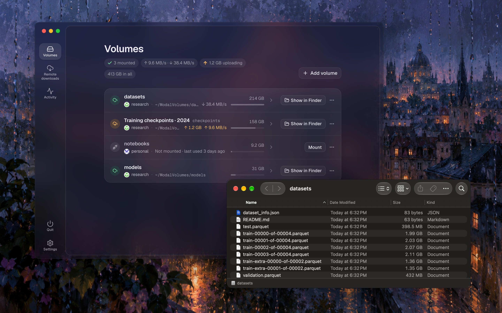
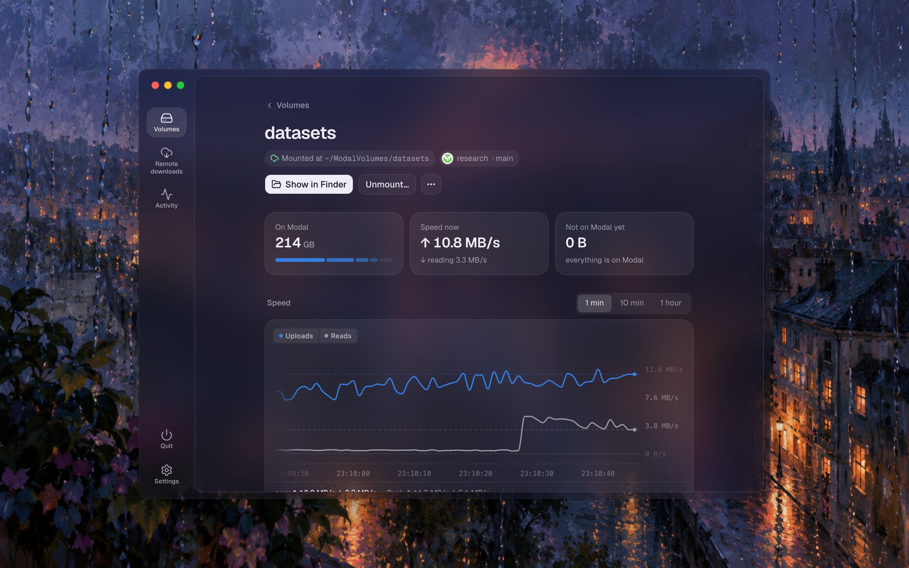
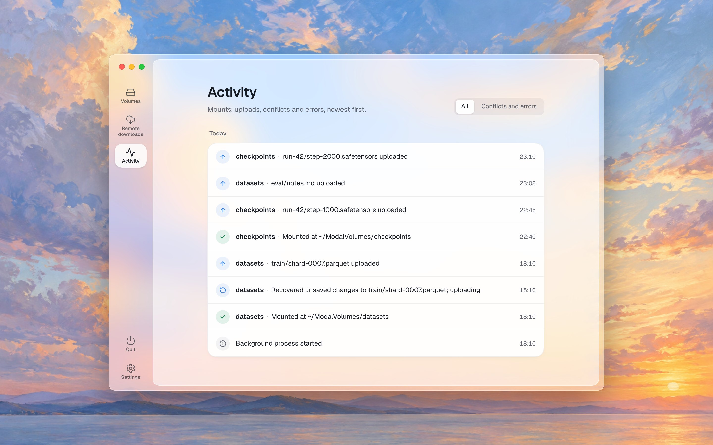
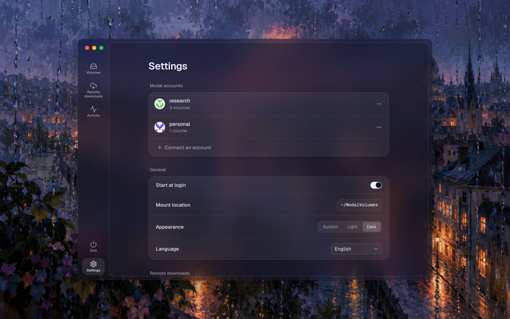
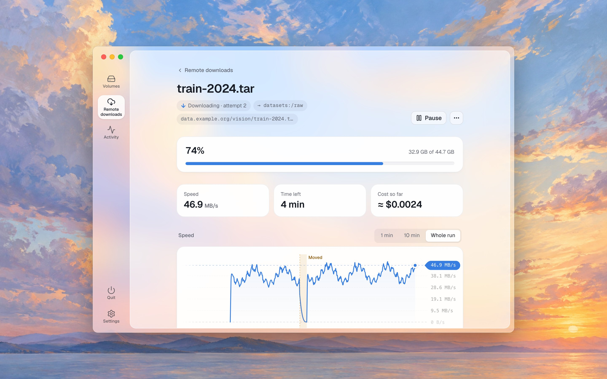

<p align="center">
  
</p>

<h1 align="center">modalfs</h1>

<p align="center">
  <b>Mount Modal Volumes as folders on your Mac.</b><br>
  Files stream on demand, so terabytes open instantly without filling your disk.
</p>

<p align="center">English · <a href="README.zh-CN.md">简体中文</a></p>

<p align="center">
  
</p>

---

modalfs mounts a [Modal Volume](https://modal.com/docs/guide/volumes) as an ordinary folder on macOS or Linux. Finder, your editor, `ffmpeg` and your agents use it like any other folder, while the data stays on Modal, where your Modal jobs read the same files.

```console
$ modalfs volume create datasets
$ modalfs mount datasets                  # → ~/ModalVolumes/datasets
$ echo hi >> ~/ModalVolumes/datasets/notes.md
$ modalfs status
VOLUME    ACCOUNT  STATE    MOUNTPOINT                  PENDING  DOWN/UP
datasets  work     mounted  /Users/me/ModalVolumes/datasets  0        0 B / 3 B
```

> [!IMPORTANT]
> modalfs is an independent project. It is **not affiliated with or endorsed by Modal Labs**. It uses the same gRPC API as Modal's official client SDKs. Parts of that API are undocumented and may change without notice. Read [Limitations](#limitations) before you put data you care about on it.

## Contents

- [Highlights](#highlights)
- [Install](#install)
- [Quick start](#quick-start)
- [The app](#the-app)
- [Remote downloads](#remote-downloads)
- [CLI reference](#cli-reference)
- [Accounts and pinning](#accounts-and-pinning)
- [How it works](#how-it-works)
- [Encrypted volumes](#encrypted-volumes)
- [Performance](#performance)
- [Limitations](#limitations)
- [Security](#security)
- [Files and configuration](#files-and-configuration)
- [FAQ](#faq)
- [Development](#development)
- [License](#license)

## Highlights

**Files open instantly.** modalfs streams only the parts of a file an app reads, straight from Modal's block store. Reading 4 KiB from the middle of a 100 GiB file fetches one 8 MiB block; reading from start to end prefetches ahead in parallel.

**Saving uploads only what changed.** Change 4 KiB of a 100 GiB file and one 8 MiB block goes up. Renames and copies move no data at all. A big copy uploads in the background while the folder stays usable.

**Works with the apps you already use.** It's a normal folder, so Finder, VS Code, Jupyter, `ffmpeg` and Blender need nothing extra. No kernel extension on macOS: the built-in NFS client mounts it. Linux uses FUSE.

**Your Modal jobs see the same files.** A Function that mounts the volume reads what you saved, and what it commits shows up in your folder within seconds.

**Download straight into a volume.** Paste a link and Modal downloads it into a volume while your Mac sleeps, with gopeed, aria2 or yt-dlp, and a live speed chart. Optional, and off until you turn it on, since it's the one feature that runs compute on Modal.

**Nothing gets lost.** Edits are journaled until Modal has them, through crashes and power loss. When a file changed on both sides, both versions are kept.

**Many accounts, never mixed up.** Each mount is pinned to its account and volume ID, so switching Modal CLI profiles or renaming a volume never points a mount somewhere else.

**Names you choose.** Give a volume a label, with spaces, emoji or any language. It's kept in the volume, so everyone using modalfs on it sees the same name, and its folder in `~/ModalVolumes` takes that name the next time it's mounted (unless you chose the folder yourself), while scripts keep using the Volume name on Modal.

**End-to-end encryption, if you want it.** An encrypted volume keeps its files, names and label unreadable to Modal. Its key, and nothing else, opens it on any computer.

**A small native app**, a menu bar icon, and a CLI that does everything the app does.

## Install

### macOS

Requires macOS 13 or later. Download `modalfs-<version>-macos.zip` from [Releases](https://github.com/t41372/modalfs/releases), unzip it, and move **modalfs.app** to Applications. It's a universal app for Apple silicon and Intel. To use the CLI from a terminal too:

```sh
sudo ln -sf /Applications/modalfs.app/Contents/Resources/bin/modalfs /usr/local/bin/modalfs
```

The app is signed ad hoc, not notarized. The first time you open it, macOS may block it. If it does, right-click the app in Finder and choose **Open**.

Only want the CLI? Releases also have `modalfs-<version>-darwin-arm64.tar.gz` and `-darwin-amd64.tar.gz`.

### Linux

Download `modalfs-<version>-linux-amd64.tar.gz` (or `-linux-arm64`) from [Releases](https://github.com/t41372/modalfs/releases), then:

```sh
tar -xzf modalfs-*-linux-amd64.tar.gz
sudo install modalfs-*-linux-amd64/modalfs /usr/local/bin/modalfs
```

FUSE must be available (`fuse3` package, `/dev/fuse`). The desktop app for x86_64 is `modalfs-gui-<version>-linux-amd64.tar.gz`; it needs WebKitGTK 4.1 (`libwebkit2gtk-4.1-0`). Without it, `modalfs ui` opens the same UI in your browser.

### From source

You need Go 1.26+, [Bun](https://bun.sh) for the UI and [just](https://github.com/casey/just) (`brew install just`). The macOS app also needs the Xcode Command Line Tools (`xcode-select --install`), and the Linux app needs `libgtk-3-dev` and `libwebkit2gtk-4.1-dev`.

```sh
git clone https://github.com/t41372/modalfs && cd modalfs
just app          # macOS: dist/modalfs.app, universal arm64 + x86_64
just cli          # CLI for macOS and Linux: dist/modalfs-{darwin,linux}-{arm64,amd64}
just linux-gui    # Linux: dist/modalfs-gui
```

On macOS 12 you can build the app yourself with Go 1.26 and `MIN_MACOS=12.0 just app`. This setup isn't tested or supported.

`go install github.com/t41372/modalfs/cmd/modalfs@latest` also works, but it can't build the UI: `modalfs ui` then shows a page saying so, and the CLI works as usual.

## Quick start

1. **Add an account.** Create a token at [modal.com → Settings → API Tokens](https://modal.com/settings/tokens), then run:

   ```sh
   modalfs account add                    # prompts for Token ID and Secret
   # or copy existing profiles from the Modal CLI:
   modalfs account import
   ```

2. **Mount a volume.** You can create one first if you need to:

   ```sh
   modalfs volume create my-data
   modalfs mount my-data                  # ~/ModalVolumes/my-data
   ```

3. **Use it.** Open the folder in Finder or your editor. modalfs commits each change about 3 seconds after the file goes idle.

4. **Unmount** when you're done. modalfs uploads anything still pending first.

   ```sh
   modalfs unmount my-data
   ```

modalfs saves each mount, so `modalfs mount my-data` reuses the same account, environment and folder next time.

## The app

`modalfs ui`, or opening **modalfs.app**, shows a small window:

| Page | What you can do |
|---|---|
| **Volumes** | The volumes modalfs manages, each with its state at a glance (synced, uploading, can't upload, a conflict, not mounted), its folder and its size. Add another volume from your account by searching for it, even among hundreds. A volume's page shows its speed now and over the last minute, ten minutes or hour, what's still waiting to upload, its conflicts with both versions a click away in Finder, and its size by folder. Its Settings hold everything that can be set: label, Volume name, mounting at login, folder, read-only, what to do on a conflict, encryption key. Mount, unmount (it says what's still uploading first), remove it from modalfs or delete it. |
| **Remote downloads** | Add links, pause, resume, delete. What's running, how fast in all and what it costs now; each one's speed over the whole run (point at the line for the acceleration there), and what happened to it. Finished ones are folded away, each with how long it ran and what it cost. |
| **Activity** | Mounts, uploads, conflicts, errors and crash recoveries, grouped by day, with notifications for the important ones. |
| **Settings** | Your Modal accounts (connect, check or replace a token, rename, default environment, disconnect), start at login, mount location, light/dark mode, language (English / 繁體中文 / 简体中文), remote downloads, and under Advanced the cache, read-ahead and connection mode. |

Quit is at the bottom of the rail, above Settings. A badge on Volumes counts the volumes that need a look.

The window is only a remote control. Mounts live in the background daemon, so **closing the window never unmounts anything**: on macOS modalfs stays in the menu bar, where its icon shows whether everything is on Modal, lists your volumes (click one to open it in Finder, or to mount it) and reopens the window. **Quitting** (⌘Q, or Quit in the menu bar menu) is different: a checklist uploads what's left, unmounts each volume one by one, then quits; a volume an app still uses can be retried or forced, and Quit now skips the waiting without losing anything. On macOS the window is glass over your desktop. In a browser (`modalfs ui` without the app), or on a phone-sized window, the same UI moves its tabs to the bottom.

<table>
  <tr>
    <td width="50%" valign="top">
      <a href="docs/screenshots/en/volume.jpg"></a>
    </td>
    <td width="50%" valign="top">
      <a href="docs/screenshots/en/activity.jpg"></a>
    </td>
  </tr>
  <tr>
    <td width="50%" valign="top">
      <a href="docs/screenshots/en/settings.jpg"></a>
    </td>
    <td width="50%" valign="top">
      <a href="docs/screenshots/en/download.jpg"></a>
    </td>
  </tr>
</table>

## Remote downloads

Give modalfs a link and a Modal Function in your workspace downloads it straight into a volume. Your computer can sleep, lose its network or be turned off meanwhile; the files appear in the folder you picked when they're complete.

- **Off until you turn it on**, on the Remote downloads page, in Settings, or with `modalfs download enable`, because it's the one thing in modalfs that runs compute. A Function starts only for a download you add or resume, and stops when it finishes, pauses or stalls.
- **What it costs:** the smallest size (0.125 CPU, 512 MiB) is about $0.01 an hour while it downloads, plus Modal's network charges (watching the live view adds about 2% of the bytes downloaded). The first download, and the first after modalfs updates, deploys the Function from a short-lived Sandbox: about 10 seconds and $0.0001. You don't need Python.
- **Downloaders:** gopeed, aria2 and yt-dlp (the latest version, every run). modalfs picks one for each link, or you choose. When gopeed keeps failing on a server, aria2 takes over by itself and starts that file over.
- **Interruptions:** Modal sometimes stops a container to move work around. The downloader's progress is saved on the volume, so the download continues on a new container from where it was, usually within a minute. A Function runs for at most 24 hours; a longer download continues in a new one by itself. Each of these shows on the download's page, on its speed chart and in plain words.
- **Live speed**, four times a second, while you watch a download in the app; the daemon relays it from the container. The record that survives everything (status, events, the speed history) is kept on the volume in `.modalfs/downloads/`.
- **Cloudflare WARP:** a download can go through Cloudflare WARP, for sites that refuse cloud servers. It's slower, and the downloader can reach nothing else: if WARP can't be reached, the download stops instead of going direct, and you can retry it without WARP.
- **Finished files never overwrite anything:** a name already taken gets ` (1)` added.
- **Money:** the Remote downloads page (and `modalfs download spend`) shows what the workspace and its downloads have spent this month. Modal's API doesn't tell the credit left or the spend limit, so for those it links to Modal's Usage & Billing page. When Modal refuses to start a download or stops one, the download's page says so; if Modal names the spend limit or credit, it says that, and otherwise it says Modal gave no reason and that the spend limit is one cause to check.

```console
$ modalfs download enable
$ modalfs download add datasets:/raw https://example.org/train-2024.tar
$ modalfs download show dl-3f2a --follow
```

See [docs/known-issues.md](docs/known-issues.md) for what remote downloads don't handle well yet.

## CLI reference

```
Everyday
  modalfs ui [--print]                        open the app (starts the daemon if needed);
                                              --print shows the browser URL instead
  modalfs status                              mounts and their sync state
  modalfs mount VOLUME [MOUNTPOINT]           mount and remember it
        [--account A] [--env E] [--ro] [--auto] [--mode auto|nfs|fuse] [--keep-junk]
  modalfs unmount VOLUME|PATH [--now]         commit pending writes, then unmount;
                                              --now unmounts at once and uploads the rest in the background
  modalfs sync VOLUME|PATH                    commit pending writes now
  modalfs forget VOLUME|PATH                  remove a saved mount (the volume is untouched)
  modalfs info VOLUME|PATH [--measure]        size, files waiting to upload, open conflicts;
                                              --measure lists the volume to measure its size
  modalfs conflicts VOLUME|PATH [--handled]   conflict copies; --handled marks them handled

Volumes
  modalfs volume ls      [--account A] [--env E]
  modalfs volume create  NAME [--label L] [--account A] [--env E] [--mount]
  modalfs volume rename  NAME NEWNAME [--account A] [--env E]
  modalfs volume label   NAME [LABEL | --clear]   a name shown instead of NAME, kept in the volume
  modalfs volume rm      NAME [--account A] [--env E] [--yes]

Encrypted volumes
  modalfs volume create  NAME --encrypt       shows the new volume's key; save it before going on
  modalfs unlock VOLUME [--remember=false]    unlock with the key (typed, or from stdin);
                                              remembered on this computer unless --remember=false
  modalfs lock VOLUME                         forget the key on this computer (unmount first)
  modalfs volume key     NAME                 show the key, where this computer remembers it
  modalfs volume decrypt NAME --to FOLDER     copy every file out, decrypted, with only the key

Accounts
  modalfs account add [--label L] [--token-id ID] [--env E]
  modalfs account import [PROFILE...]
  modalfs account ls
  modalfs account check ACCOUNT               ask Modal whether the token still works
  modalfs account token ACCOUNT               replace an expired token (same workspace)
  modalfs account rename ACCOUNT NEWNAME
  modalfs account env ACCOUNT ENVIRONMENT     the environment new volumes are looked up in
  modalfs account rm ACCOUNT

Remote downloads (off until enabled; each runs in a Modal Function billed to your account)
  modalfs download enable|disable             turn remote downloads on or off
  modalfs download add VOLUME[:/FOLDER] URL...
        [--downloader gopeed|aria2|yt-dlp] [--size small|medium|large] [--cookies FILE]
        [--warp | --no-warp] [--account A] [--env E]
  modalfs download ls
  modalfs download show ID [--follow]         progress, attempts and interruptions, speed
  modalfs download pause ID
  modalfs download resume ID [--warp | --no-warp]
  modalfs download cancel ID [--keep]         stop it and delete the partial files
  modalfs download logs ID                    the downloader's log
  modalfs download rm ID                      forget it (finished files stay)
  modalfs download spend [--account A]        what the workspace and its downloads spent this month

Background process
  modalfs daemon                              run the daemon in the foreground
  modalfs quit [--now]                        commit everything, unmount, stop the daemon;
                                              --now stops at once (pending writes upload at the next mount)
  modalfs service install|uninstall           start at login (LaunchAgent / systemd user unit)
  modalfs cache clear                         delete the local block cache (changes not yet uploaded are kept)

Without the daemon (scripts, debugging)
  modalfs run VOLUME MOUNTPOINT [flags]       foreground mount until Ctrl-C
  modalfs serve VOLUME [flags]                NFS server only; prints the mount command
```

`--account` takes a label, an account ID or a workspace name. With only one account, you can leave it out.

## Accounts and pinning

People often switch between several Modal workspaces. modalfs is designed so that a mount never silently follows that switch.

- **Own account store.** modalfs keeps tokens in its own list and secrets in the OS keychain. It never reads the Modal CLI's *active* profile. It reads `~/.modal.toml` only when you run `account import`, and then copies the token.
- **Each mount pins** the account, environment, volume name **and volume ID**.
  - If the volume is **renamed**, modalfs finds it by ID, updates the name and mounts it.
  - If the volume was **deleted and a new one reuses the name**, modalfs refuses to mount and asks you to re-pin. It never mounts a different volume under the old name.

## How it works

```
Finder / editor / agent
  ├─ macOS NFS client ── NFSv3 on 127.0.0.1 (go-nfs) ┐
  └─ Linux FUSE (go-fuse) ───────────────────────────┤
                                                     ▼
   modalfs daemon ─ vfs: dir cache (TTL) · content-addressed block cache (LRU, shared)
                    per-file dirty-block overlay + journal · manifest DB · write-back
                                                     ▼
   Modal control plane (gRPC): VolumeListFiles2 · GetFile2 · PutFiles2 · CopyFiles2 · RemoveFile2
   Modal block store: signed GET / PUT URLs
```

**Volume v2 is content-addressed.** A file is a list of SHA-256 hashes of 8 MiB blocks. `VolumePutFiles2` takes that list and reports only the blocks the server doesn't already have, and this dedup works across files and even across volumes. `VolumeGetFile2` returns one signed URL per block for any byte range. `VolumeCopyFiles2` copies manifests. For example, it copied a 100 GiB file in 2.9 s.

So a partial write works like this: keep the hashes of unchanged blocks, hash the changed ones, send the new manifest, and upload whatever the server says is missing.

**Large writes upload as they go.** When a file has several changed blocks (a long copy, say), modalfs uploads each block once it has stopped changing for half a second, without waiting for the file to be done, and commits the file in parts: each part is the start of the file up to the first block that isn't on Modal yet, so it's one quick call with nothing left to upload. A part is always the file as it was, cut at a block boundary, never a mix of old and new. Once the file is idle, the usual commit finishes it. Uploads run several at a time, as many as keep each 8 MiB block to about 5 s on your link: 4 to 32 (one connection only moves a few MiB/s, because Modal takes about a second and a half to answer each block).

**Behaviour Modal doesn't document.** Uploading ahead relies on three things measured, not promised: a commit request with a made-up first block never commits but still hands out upload URLs; a block uploaded that way counts for a later commit, of any file in the volume, only with the receipt its upload returned (receipts 15 minutes old still work; modalfs uses them for 10); and Modal refuses bytes that don't match their hash. The contract tests (`just test-modal-contract PROFILE`) check these against real Modal every day. If Modal changes, modalfs turns uploading ahead off and says so in Activity; each file is then uploaded when it's committed, as before, and nothing is lost. Blocks uploaded ahead but never committed (a file deleted first, or a crash) stay in Modal's block store; whether Modal removes or bills them isn't documented.

**The catch:** the API never returns the hashes of existing blocks. modalfs learns them in three ways:

1. **Local manifest DB** (bbolt). Every full block modalfs reads gets hashed and recorded under `(path, size, mtime)`.
2. **Sidecars.** For large files modalfs writes (≥ 64 MiB), it stores the block list in `/.modalfs/manifests/<path>.json` inside the volume. Other modalfs clients, or a fresh cache, can then edit those files immediately. A sidecar is trusted only when size and mtime match.
3. **Fallback.** If neither exists, for example for a big file a Modal container just wrote, the first partial write streams the unseen blocks once to hash them. modalfs doesn't store them on disk.

Other details:

- **Directories.** Modal has no real empty directories, so `mkdir` writes a hidden `.modalfs_keep` marker.
- **Renames** are copy + remove at the manifest level, so atomic saves from editors work.
- **Conflicts.** Before each commit, modalfs re-checks the remote file. If someone else changed it while you were editing, your version is saved as `name.conflict-YYYYMMDD-HHMMSS.ext`. You can set the policy to *overwrite* instead.
- **macOS litter.** `.DS_Store` and `._*` files stay in memory and are never uploaded. This is on by default and can be turned off per mount.

## Encrypted volumes

A new volume can be encrypted end to end: its files, their names and its label are encrypted on your computer before they leave it, so Modal, and anyone else who can read the workspace, sees only ciphertext. On your computer the folder works as usual.

Turn on **Encrypt end to end** when you create a volume in the app, or run `modalfs volume create NAME --encrypt`. modalfs then shows the volume's key, a line that starts with `mfs1-`. **Save it, for example in your password manager.** The key and the files on Modal are all it takes to read them, on any computer, even after modalfs's own files are gone. Without the key nobody can read them, not even modalfs: there's no passphrase and no recovery.

- This computer remembers the key (in the keychain on macOS; the secret store or a private file on Linux), so the volume mounts by itself. On another computer it shows as locked: click Unlock and paste the key, or run `modalfs unlock NAME`.
- Encryption protects what's on Modal, not this computer: the cache, changes not yet uploaded and conflict copies stay readable here. Forgetting the key (`modalfs lock`) doesn't remove them; clear the cache (Settings, or `modalfs cache clear`) before handing the computer to someone else.
- Modal Functions can't read an encrypted volume, and remote downloads can't save into one.
- `modalfs volume decrypt NAME --to FOLDER` copies every file out, decrypted, with only the key: no mount, nothing remembered.
- Modal still sees how many files and folders there are, the folder shape, sizes, times, and which 8 MiB blocks are identical.
- A name can be up to 147 bytes (about 49 Chinese characters). Renaming a folder with many files takes one request per file. Only new volumes can be encrypted, and a volume's key can't be changed.

[The format and every trade-off](docs/design/encryption.md) are written down in full, enough to decrypt a volume without modalfs.

## Performance

Measured from a Linux arm64 sandbox through an HTTP/1.1 proxy with limited bandwidth. Expect better numbers on a normal connection.

| Operation | Result |
|---|---|
| Cold 4 KiB read at offset 77 GiB of a 100 GiB file | 1.45 s, then 0 ms from cache |
| Sequential read, 512 MiB | 40.9 MiB/s (single-block GETs capped at ~7 MB/s by the sandbox) |
| Change 4 KiB in a 100 GiB file | 8 MiB uploaded, committed in ~3.5 s |
| Change 4 KiB in a 50 MB file | 1 block uploaded, 2.0 s |
| Change 5 bytes in a never-seen 20 MB file | 2 blocks streamed to hash + 1 uploaded, 3.7 s |
| Copy / rename a 100 GiB file | 2.9 s, no data transfer |
| `kill -9` mid-write, then restart | changes recovered and committed, checksum identical |

## Limitations

- **Volume v2 only.** v1 volumes are listed but can't be mounted.
- **No locking.** Modal has no compare-and-swap, so with several writers on the same file, the last commit wins. modalfs detects this on a best-effort basis and keeps a conflict copy.
- **8 MiB granularity.** Small random writes still upload whole 8 MiB blocks.
- **Metadata.** Modal sets mtime at commit. modalfs accepts chmod, chown and utimes but ignores them. There are no symlinks, hard links or xattrs.
- **Consistency** is close-to-open plus a 10 s directory cache. Changes from other machines show up within that window. Modal containers need `volume.reload()` to see what you wrote.
- **Write-back delay.** NFS has no close event, so writes reach Modal about 3 s after a file goes idle, or every 30 s while it keeps changing (a long copy uploads as it's written and is committed in parts). After a crash they are recovered. One edge case: if the last second of an append was all zero bytes, those trailing zeros can be dropped.
- **Unmounting waits for uploads.** Turning a mount off first uploads what's pending, with progress shown; **Unmount now** unmounts at once and finishes uploading in the background (or at the next mount). macOS won't unmount a folder an app has open, and the app says which one.
- **The daemon must keep running while volumes are mounted**, because the NFS/FUSE server lives inside it. If it dies, the next start cleans up stale mounts.
- **The menu bar icon is macOS-only.** On Linux, use `modalfs ui` to reopen the window.
- **Undocumented API.** modalfs relies on the RPCs the official SDKs use. If Modal changes them, modalfs may break until it's updated.
- **macOS status.** The NFS server, daemon, FUSE mounts, crash recovery, rename following and the app's UI have all been tested on Linux, and the macOS app builds as a universal binary. The macOS NFS mount and the macOS app still need wider real-world testing. Bug reports are welcome.

## Security

- **Token secrets** live in the macOS Keychain or the Linux Secret Service. On headless Linux without a keychain, they fall back to `secrets.json` with mode `0600`. They are never written to logs.
- **The daemon listens on** a Unix socket (`0600`, in your config folder) for the CLI and the app, and on a random `127.0.0.1` port for the browser UI. The link `modalfs ui` opens carries a token that works once and is traded for a cookie; every request also needs a loopback `Host` header and a custom header, which blocks other local web pages and DNS rebinding.
- **The NFS server** listens on `127.0.0.1` and only answers requests carrying your user's credentials, so other people using the same Mac can't mount your volumes. See [docs/known-issues.md](docs/known-issues.md) for what that doesn't cover.
- **Destructive actions** (deleting a volume, removing an account) require explicit confirmation. A mounted volume can't be deleted.
- Please report vulnerabilities privately (see [SECURITY.md](SECURITY.md)) rather than in public issues.

## Files and configuration

| | macOS | Linux |
|---|---|---|
| Config, accounts, socket, log | `~/Library/Application Support/modalfs/` | `~/.config/modalfs/` |
| Block cache | `~/Library/Caches/modalfs/` | `~/.cache/modalfs/` |
| Default mount folder | `~/ModalVolumes/` | `~/ModalVolumes/` |
| Start at login | `~/Library/LaunchAgents/dev.modalfs.daemon.plist` | `~/.config/systemd/user/modalfs.service` |

**Cache size.** This is all the disk modalfs uses: blocks read from Modal, shared by every volume, plus changes that aren't on Modal yet. Changes come first, and cached blocks make way for them. When changes fill the limit (all of it but a quarter, at most 1 GiB, kept for reading), new writes wait for uploads to make room. A copy larger than the limit still works, at the speed of your upload, and modalfs never fills your disk. A long copy uploads as it's written, and each part leaves the disk once it's committed, so a write waits for a block or two to upload, not for the whole file. Still, on macOS a copy larger than the limit can pause for half a minute or more at a time once writes wait (the system's NFS client holds them back too): keep the cache larger than your largest copy. Writes also wait while less than 1 GiB is free on the disk, or fail at once, with an error in Activity, if nothing waiting to upload could free it.

If Modal can't be reached, apps writing to a volume wait; on macOS they give up after a few minutes, like with a network drive that went away. What they already wrote stays on this computer and uploads later, and the app says it can't upload and why.

Settings accepts any whole number of GB from 1. The default is 20 GB, and 2 GB or more is recommended (roughly 2 × concurrent readers × (read-ahead + 1) × 8 MiB, plus 256 MiB).

Environment variables:

| Variable | Effect |
|---|---|
| `MODALFS_HOME` | Put config and cache somewhere else (handy for testing) |
| `MODALFS_TRANSPORT=http1` | Send gRPC over HTTP/1.1, for proxies that only allow HTTP/1.1 |
| `MODALFS_NO_KEYCHAIN=1` | Store secrets in `secrets.json` instead of the keychain |
| `MODALFS_DEBUG=1` | Verbose daemon logging |

## FAQ

**Does mounting cost Modal compute?**
No. Mounting makes API calls only. Storage and bandwidth are billed by Modal as usual. Only [remote downloads](#remote-downloads), which are off until you turn them on, run a Function.

**Can a Modal Function use the same volume at the same time?**
Yes. Call `volume.reload()` in the container to see changes made through modalfs, and avoid having both sides write the same file at once.

**Why NFS on macOS instead of FUSE?**
macFUSE needs a kernel extension, or a system-settings dance on Apple silicon. The built-in NFS client needs nothing. `--mode fuse` is there if you already use macFUSE.

**Do I have to keep the app open?**
No. Only the background daemon has to keep running. Turn on **Start at login** and **Mount automatically**, and your volumes are there after every reboot.

**Where did my edit go after a crash?**
modalfs replays it on the next start and commits it. Check **Activity** for a "recovered" entry, or a conflict copy if the remote file changed in the meantime.

## Development

Tasks run through [just](https://github.com/casey/just); run `just` to list them. The UI needs [Bun](https://bun.sh).

```sh
just build                                   # CLI/daemon for this machine → dist/modalfs
just dev-mock                                # the UI with hot reload on sample data: no daemon, no Modal account
just dev                                     # the UI with hot reload against your running daemon
just lint                                    # gofmt, go vet, and the UI's typecheck and translations
just cli                                     # cross-compile CLI/daemon for all platforms
just app                                     # macOS app (on a Mac)
just test-e2e                                # real NFS mounts against a fake Modal with a slow network (macOS)
just fake -up 20M                            # a fake Modal to try modalfs without an account
MODALFS_TEST_VOLUME=scratch just test-integration   # CREATES AND DELETES files in that volume
```

The UI is React with Tailwind and shadcn/ui on Base UI, in the style of [Jezo](https://github.com/t41372/Jezo). `just ui` builds it into `internal/webui/dist`, which the daemon and the app embed. The pictures in this README come from `cd web && bun run screenshots`: it builds the UI on the sample data in `web/src/api/mock.ts` (its calm `?scenario=demo`), shoots each page at the app's own window size in each README language, and lays the see-through window over a painting in `docs/screenshots/backdrops/` (Jezo's). The first picture adds a real Finder window, captured from a mount of the fake Modal by `web/scripts/capture-finder.sh`.

Layout:

```
cmd/modalfs        CLI + daemon entry point (pure Go)
cmd/modalfs-gui    desktop app (Wails v2); can also run the daemon
internal/modalapi  Modal gRPC client, block upload/download, volume management
internal/vfs       filesystem core: caches, dirty overlay, journal, conflicts
internal/nfsfront  NFSv3 frontend (go-nfs)
internal/fusefront FUSE frontend (go-fuse)
internal/daemon    mount manager, JSON API, start-at-login
internal/config    accounts, saved mounts, settings, secrets
internal/webui     embeds the built UI for the daemon and the app
web                the UI's source (React, Vite); strings in web/src/i18n
packaging          icon, macOS app bundle script (`just app`)
docs/screenshots   the README's pictures, made by web/scripts/screenshots.ts
```

Contributions are welcome. Testing on real Macs is especially helpful: NFS mounts, the app, Keychain and the LaunchAgent. See [CONTRIBUTING.md](CONTRIBUTING.md) for setup, and run `just lint` and, where you can, the integration tests against a scratch volume before you open a PR.

## License

[Apache License 2.0](LICENSE).

Modal is a trademark of Modal Labs, Inc. This project is not affiliated with Modal Labs.
