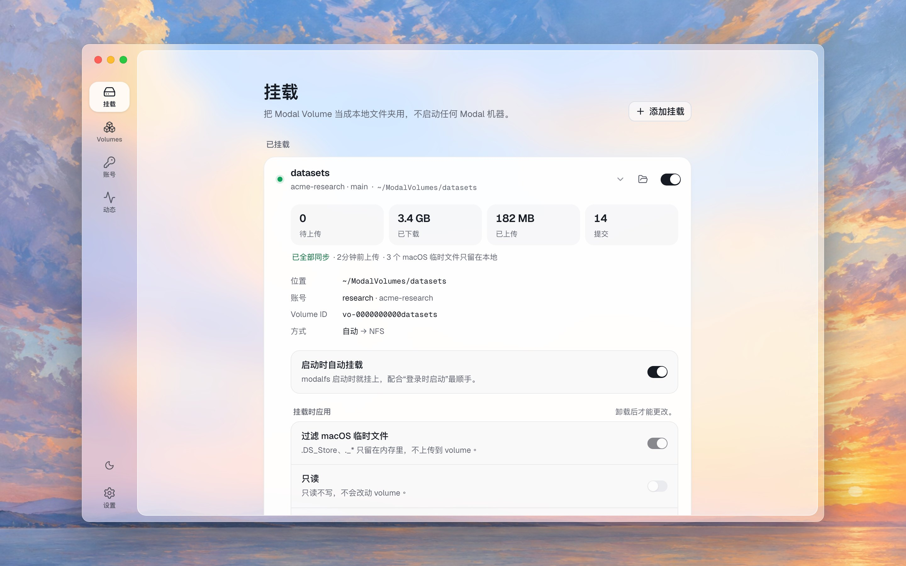

<p align="center">
  
</p>

<h1 align="center">modalfs</h1>

<p align="center">
  <b>在 macOS 和 Linux 上把 Modal Volume 挂载成本地文件夹，不启动任何 Modal 计算资源。</b>
</p>

<p align="center"><a href="README.md">English</a> · 简体中文</p>

<p align="center">
  
</p>

---

有了 modalfs，访达、编辑器、`ffmpeg` 和 AI agent 都能把 [Modal Volume](https://modal.com/docs/guide/volumes) 当成普通文件夹来用。读取直接从 Modal 的块存储流式获取；写入从你的电脑提交，只上传你改过的 8 MiB 块。modalfs **从不启动 Sandbox、Function 或容器**，所以挂载不花计算费用。

```console
$ modalfs volume create datasets
$ modalfs mount datasets                  # → ~/ModalVolumes/datasets
$ echo hi >> ~/ModalVolumes/datasets/notes.md
$ modalfs status
VOLUME    ACCOUNT  STATE    MOUNTPOINT                  PENDING  DOWN/UP
datasets  work     mounted  /Users/me/ModalVolumes/datasets  0        0 B / 3 B
```

> [!IMPORTANT]
> modalfs 是独立项目，**与 Modal Labs 无关，也没有得到其认可**。它用的是 Modal 官方客户端 SDK 所用的同一套 gRPC API，其中一部分没有公开文档，可能随时变化。把重要数据放上去之前，请先读[限制](#限制)。

## 目录

- [特点](#特点)
- [安装](#安装)
- [快速上手](#快速上手)
- [应用](#应用)
- [命令行参考](#命令行参考)
- [账号与绑定](#账号与绑定)
- [工作原理](#工作原理)
- [性能](#性能)
- [限制](#限制)
- [安全](#安全)
- [文件与配置](#文件与配置)
- [常见问题](#常见问题)
- [开发](#开发)
- [许可证](#许可证)

## 特点

- **零计算。** modalfs 只调用 Modal 的控制面 API 和签名的块存储 URL，Modal 那边什么都不运行。
- **macOS 上不需要内核扩展。** modalfs 在本机提供 NFSv3 服务，由 macOS 自带的 NFS 客户端挂载。Linux 用 FUSE。如果你更喜欢 macFUSE，也可以用。
- **按需、按范围读取。** 打开一个 100 GiB 的文件、从中间读 4 KiB，只会下载一个 8 MiB 块。顺序读取会并行预读。
- **块级写入。** Volume v2 按内容寻址。改动 100 GiB 文件里的 4 KiB，只上传一个 8 MiB 块并提交新的清单。重命名和复制只改清单，不传数据。
- **创建、重命名、删除 volume**，这些 Modal 网页控制台目前还做不到。
- **多账号，每个挂载各自绑定。** modalfs 有自己的账号列表，不理会 Modal CLI 当前启用的 profile，所以切换 profile 不会把挂载换到别的工作区。
- **崩溃也不丢的回写。** 没上传的修改会记在本地日志里，下次启动时提交，即使经历了 `kill -9`。应用保存（关闭或 fsync）的数据，在应用收到“已保存”之前就已写入磁盘，所以断电也不会丢。
- **上传时照常可用。** 13 GB 的文件会在后台上传，边写边传；上传期间访达、读取和其他文件都照常工作。
- **一个小巧的原生应用**，配套的命令行，登录时启动和自动挂载。

## 安装

### macOS

需要 macOS 13 或更新版本。从 [Releases](https://github.com/t41372/modalfs/releases) 下载 `modalfs-<版本>-macos.zip`，解压后把 **modalfs.app** 拖进“应用程序”。它是同时支持 Apple 芯片和 Intel 的通用应用。如果也想在终端里用命令行：

```sh
sudo ln -sf /Applications/modalfs.app/Contents/Resources/bin/modalfs /usr/local/bin/modalfs
```

应用只做了 ad hoc 签名，没有公证。第一次打开时 macOS 可能会拦下它；这时在访达里右键点按应用，选“打开”。

只要命令行？Releases 里也有 `modalfs-<版本>-darwin-arm64.tar.gz` 和 `-darwin-amd64.tar.gz`。

### Linux

从 [Releases](https://github.com/t41372/modalfs/releases) 下载 `modalfs-<版本>-linux-amd64.tar.gz`（或 `-linux-arm64`），然后：

```sh
tar -xzf modalfs-*-linux-amd64.tar.gz
sudo install modalfs-*-linux-amd64/modalfs /usr/local/bin/modalfs
```

系统需要支持 FUSE（`fuse3` 软件包、`/dev/fuse`）。x86_64 的桌面应用是 `modalfs-gui-<版本>-linux-amd64.tar.gz`，需要 WebKitGTK 4.1（`libwebkit2gtk-4.1-0`）。没有它的话，`modalfs ui` 会在浏览器里打开同样的界面。

### 从源码构建

需要 Go 1.26+、用来构建界面的 [Bun](https://bun.sh) 和 [just](https://github.com/casey/just)（`brew install just`）。macOS 应用还需要 Xcode 命令行工具（`xcode-select --install`），Linux 应用需要 `libgtk-3-dev` 和 `libwebkit2gtk-4.1-dev`。

```sh
git clone https://github.com/t41372/modalfs && cd modalfs
just app          # macOS：dist/modalfs.app，arm64 + x86_64 通用版
just cli          # macOS 和 Linux 的命令行：dist/modalfs-{darwin,linux}-{arm64,amd64}
just linux-gui    # Linux：dist/modalfs-gui
```

在 macOS 12 上，可以用 Go 1.26 和 `MIN_MACOS=12.0 just app` 自己构建应用。这种组合没有测试过，也不提供支持。

`go install github.com/t41372/modalfs/cmd/modalfs@latest` 也能用，但它没法构建界面：这时 `modalfs ui` 会显示一页说明，命令行照常可用。

## 快速上手

1. **添加账号。** 在 [modal.com → Settings → API Tokens](https://modal.com/settings/tokens) 创建一个 token，然后运行：

   ```sh
   modalfs account add                    # 会提示输入 Token ID 和 Secret
   # 或者从 Modal CLI 复制已有的 profile：
   modalfs account import
   ```

2. **挂载一个 volume。** 需要的话可以先创建一个：

   ```sh
   modalfs volume create my-data
   modalfs mount my-data                  # ~/ModalVolumes/my-data
   ```

3. **开始使用。** 在访达或编辑器里打开这个文件夹。文件停止变动约 3 秒后，modalfs 会提交这次修改。

4. 用完后**卸载**。modalfs 会先把还没上传的内容传完。

   ```sh
   modalfs unmount my-data
   ```

modalfs 会记住每个挂载，所以下次 `modalfs mount my-data` 会沿用同一个账号、环境和文件夹。

## 应用

运行 `modalfs ui`，或者打开 **modalfs.app**，会出现一个小窗口：

| 页面 | 可以做什么 |
|---|---|
| **挂载** | 用开关挂载或卸载。查看待上传文件、流量、提交次数和冲突。立即同步、在访达中显示、强制卸载。每个挂载的选项：自动挂载、只读、过滤 macOS 临时文件、冲突策略、NFS/FUSE。 |
| **Volumes** | 按账号和环境浏览 volume。创建、重命名、删除（要输入名称确认）、挂载。 |
| **账号** | 添加 token、从 `~/.modal.toml` 导入、检查 token 是否仍然有效、移除。 |
| **动态** | 挂载、上传、冲突、错误和崩溃恢复，按天分组，重要的会发通知。 |
| **设置** | 语言（English / 繁體中文 / 简体中文）、浅色/深色、登录时启动、缓存大小、预读、默认挂载位置、连接方式。 |

窗口只是个遥控器。挂载都在后台进程里，所以**关掉窗口不会卸载任何东西**。在 macOS 上，窗口是一层透出桌面的玻璃。在浏览器里（没装应用时的 `modalfs ui`）或手机大小的窗口里，同一个界面会把标签移到底部。

<table>
  <tr>
    <td width="50%" valign="top">
      <a href="docs/screenshots/zh-CN/volumes.jpg"></a>
    </td>
    <td width="50%" valign="top">
      <a href="docs/screenshots/zh-CN/activity.jpg"></a>
    </td>
  </tr>
  <tr>
    <td width="50%" valign="top">
      <a href="docs/screenshots/zh-CN/settings.jpg"></a>
    </td>
    <td width="50%" valign="top"></td>
  </tr>
</table>

## 命令行参考

```
日常
  modalfs ui [--print]                        打开应用（需要时启动后台进程）；
                                              --print 改为显示浏览器地址
  modalfs status                              各个挂载及其同步状态
  modalfs mount VOLUME [MOUNTPOINT]           挂载并记住它
        [--account A] [--env E] [--ro] [--auto] [--mode auto|nfs|fuse] [--keep-junk]
  modalfs unmount VOLUME|PATH [--now]         提交待上传的写入，然后卸载；
                                              --now 立即卸载，剩下的在后台继续上传
  modalfs sync VOLUME|PATH                    立即提交待上传的写入
  modalfs forget VOLUME|PATH                  删除保存的挂载（volume 本身不受影响）

Volumes
  modalfs volume ls      [--account A] [--env E]
  modalfs volume create  NAME [--account A] [--env E] [--mount]
  modalfs volume rename  NAME NEWNAME [--account A] [--env E]
  modalfs volume rm      NAME [--account A] [--env E] [--yes]

账号
  modalfs account add [--label L] [--token-id ID] [--env E]
  modalfs account import [PROFILE...]
  modalfs account ls
  modalfs account rm ACCOUNT

后台进程
  modalfs daemon                              在前台运行后台进程
  modalfs quit [--now]                        提交所有内容、卸载、停止后台进程；
                                              --now 立即停止（待上传的写入在下次挂载时上传）
  modalfs service install|uninstall           登录时启动（LaunchAgent / systemd 用户单元）

不经过后台进程（脚本、调试）
  modalfs run VOLUME MOUNTPOINT [flags]       在前台挂载，直到 Ctrl-C
  modalfs serve VOLUME [flags]                只启动 NFS 服务，并打印挂载命令
```

`--account` 可以是名称、账号 ID 或工作区名称。只有一个账号时可以省略。

## 账号与绑定

很多人会在几个 Modal 工作区之间切换。modalfs 的设计保证挂载不会悄悄跟着切换。

- **独立的账号存储。** modalfs 把 token 记在自己的列表里，secret 存在系统钥匙串里。它从不读取 Modal CLI *当前启用*的 profile，只在你运行 `account import` 时读取 `~/.modal.toml`，并复制一份 token。
- **每个挂载都绑定**账号、环境、volume 名称**和 volume ID**。
  - 如果 volume 被**重命名**，modalfs 会按 ID 找到它，更新名称后挂载。
  - 如果 volume 被**删除、又有新的 volume 用了同一个名字**，modalfs 会拒绝挂载，请你重新绑定。它绝不会在旧名称下挂载另一个 volume。

## 工作原理

```
访达 / 编辑器 / agent
  ├─ macOS NFS 客户端 ── 127.0.0.1 上的 NFSv3 (go-nfs) ┐
  └─ Linux FUSE (go-fuse) ─────────────────────────────┤
                                                       ▼
   modalfs 后台进程 ─ vfs：目录缓存（TTL）· 按内容寻址的块缓存（LRU，共享）
                      每个文件的脏块覆盖层 + 日志 · 清单数据库 · 回写
                                                       ▼
   Modal 控制面 (gRPC)：VolumeListFiles2 · GetFile2 · PutFiles2 · CopyFiles2 · RemoveFile2
   Modal 块存储：签名的 GET / PUT URL
```

**Volume v2 按内容寻址。** 一个文件就是一串 8 MiB 块的 SHA-256 哈希。`VolumePutFiles2` 接收这串哈希，只报告服务器还没有的块，而且这种去重跨文件、甚至跨 volume 生效。`VolumeGetFile2` 对任意字节范围，每个块返回一个签名 URL。`VolumeCopyFiles2` 复制清单，例如复制一个 100 GiB 的文件只用了 2.9 秒。

所以局部写入是这样完成的：保留未改动块的哈希，计算改动块的哈希，发送新清单，再上传服务器说缺少的块。

**问题在于：** API 从不返回已有块的哈希。modalfs 通过三种方式得到它们：

1. **本地清单数据库**（bbolt）。modalfs 读到的每个完整块都会计算哈希，按 `(路径, 大小, mtime)` 记录下来。
2. **Sidecar 文件。** modalfs 写入的大文件（≥ 64 MiB）会把块列表存进 volume 里的 `/.modalfs/manifests/<路径>.json`。这样其他 modalfs 客户端，或者缓存刚清空的本机，都能立刻编辑这些文件。只有大小和 mtime 都对得上时才会采信 sidecar。
3. **兜底。** 两者都没有时，例如 Modal 容器刚写好的大文件，第一次局部写入会把没见过的块流式读一遍来算哈希。modalfs 不会把它们存到磁盘上。

其他细节：

- **目录。** Modal 没有真正的空目录，所以 `mkdir` 会写一个隐藏的 `.modalfs_keep` 标记。
- **重命名**在清单层面是复制 + 删除，所以编辑器的原子保存可以正常工作。
- **冲突。** 每次提交前，modalfs 会重新检查远端文件。如果在你编辑期间别人改过它，你的版本会另存为 `name.conflict-YYYYMMDD-HHMMSS.ext`。你也可以把策略改成*覆盖*。
- **macOS 临时文件。** `.DS_Store` 和 `._*` 文件只留在内存里，从不上传。默认开启，可以按挂载关闭。

## 性能

在一个 Linux arm64 沙箱里测得，经过带宽受限的 HTTP/1.1 代理。普通网络下数字会更好。

| 操作 | 结果 |
|---|---|
| 在 100 GiB 文件的 77 GiB 偏移处冷读 4 KiB | 1.45 秒，之后从缓存读 0 毫秒 |
| 顺序读取 512 MiB | 40.9 MiB/s（沙箱把单块 GET 限制在约 7 MB/s） |
| 改动 100 GiB 文件中的 4 KiB | 上传 8 MiB，约 3.5 秒提交 |
| 改动 50 MB 文件中的 4 KiB | 上传 1 个块，2.0 秒 |
| 改动一个从没见过的 20 MB 文件中的 5 字节 | 流式读 2 个块算哈希 + 上传 1 个块，3.7 秒 |
| 复制 / 重命名 100 GiB 文件 | 2.9 秒，不传数据 |
| 写入途中 `kill -9`，然后重启 | 修改被恢复并提交，校验和一致 |

## 限制

- **只支持 Volume v2。** v1 volume 会列出来，但无法挂载。
- **没有锁。** Modal 没有比较并交换（CAS），所以多个写入者写同一个文件时，最后一次提交胜出。modalfs 会尽力检测这种情况，并保留一份冲突副本。
- **8 MiB 粒度。** 小的随机写入也会上传整个 8 MiB 块。
- **元数据。** Modal 在提交时设置 mtime。modalfs 接受 chmod、chown 和 utimes，但会忽略它们。不支持符号链接、硬链接和扩展属性。
- **一致性**是打开时一致（close-to-open），外加 10 秒的目录缓存。其他机器上的改动会在这段时间内出现。Modal 容器需要调用 `volume.reload()` 才能看到你写的内容。
- **回写延迟。** NFS 没有关闭事件，所以文件停止变动约 3 秒后写入才会到达 Modal；持续变动的文件至少每 30 秒提交一次。崩溃后会恢复。一个边缘情况：如果追加写入的最后一秒全是零字节，这些结尾的零可能会丢失。
- **卸载要等上传。** 关闭挂载会先上传待上传的内容，并显示进度；**立即卸载**会马上卸载，剩下的在后台（或下次挂载时）上传。macOS 不会卸载正被应用打开的文件夹，modalfs 会告诉你是哪个应用。
- **挂载期间后台进程必须一直运行**，因为 NFS/FUSE 服务就在它里面。如果它挂了，下次启动时会清理残留的挂载。
- **还没有菜单栏图标。** Wails v2 不支持托盘。用 `modalfs ui` 重新打开窗口。
- **未公开的 API。** modalfs 依赖官方 SDK 所用的 RPC。如果 Modal 改了它们，modalfs 在更新之前可能无法使用。
- **macOS 的状况。** NFS 服务、后台进程、FUSE 挂载、崩溃恢复、跟随重命名和应用界面都已在 Linux 上测试，macOS 应用可以构建成通用二进制。macOS 上的 NFS 挂载和 macOS 应用还需要更多真实环境的测试，欢迎报告问题。

## 安全

- **Token secret** 存在 macOS 钥匙串或 Linux Secret Service 里。在没有钥匙串的无界面 Linux 上，会退而存进权限为 `0600` 的 `secrets.json`。它们从不写进日志。
- **后台进程监听**一个 Unix 套接字（`0600`，在配置文件夹里）供命令行和应用使用，并在一个随机的 `127.0.0.1` 端口上提供浏览器界面。`modalfs ui` 打开的链接带一个只能用一次的 token，用后换成 cookie；每个请求还需要回环地址的 `Host` 头和一个自定义请求头，以挡住本机的其他网页和 DNS 重绑定。
- **NFS 服务**只监听 `127.0.0.1`，并只接受带你这个用户凭据的请求，所以共用这台 Mac 的其他人挂载不了你的 volume。它防不住什么，见 [docs/known-issues.md](docs/known-issues.md)。
- **破坏性操作**（删除 volume、移除账号）需要明确确认。已挂载的 volume 不能删除。
- 请私下报告安全漏洞（见 [SECURITY.md](SECURITY.md)），不要发在公开的 issue 里。

## 文件与配置

| | macOS | Linux |
|---|---|---|
| 配置、账号、套接字、日志 | `~/Library/Application Support/modalfs/` | `~/.config/modalfs/` |
| 块缓存 | `~/Library/Caches/modalfs/` | `~/.cache/modalfs/` |
| 默认挂载位置 | `~/ModalVolumes/` | `~/ModalVolumes/` |
| 登录时启动 | `~/Library/LaunchAgents/dev.modalfs.daemon.plist` | `~/.config/systemd/user/modalfs.service` |

**缓存大小。** 块缓存只存 Modal 上已经有的数据，所以设成多少都安全：太小只是会重复下载。设置里可以填 1 以上的任意整数 GB，建议至少 2 GB（大约是 2 × 同时读取的文件数 × (预读块数 + 1) × 8 MiB，再加 256 MiB）。还没上传的修改另外存在磁盘上，不计入缓存，所以写一个 100 GiB 的文件，在提交之前需要 100 GiB 的空闲空间。

环境变量：

| 变量 | 作用 |
|---|---|
| `MODALFS_HOME` | 把配置和缓存放到别处（测试时很方便） |
| `MODALFS_TRANSPORT=http1` | 通过 HTTP/1.1 发送 gRPC，用于只允许 HTTP/1.1 的代理 |
| `MODALFS_NO_KEYCHAIN=1` | 把 secret 存进 `secrets.json`，不用钥匙串 |
| `MODALFS_DEBUG=1` | 后台进程输出详细日志 |

## 常见问题

**挂载会花 Modal 的计算费用吗？**
不会。modalfs 只调用 API。存储和流量照常由 Modal 计费。

**Modal Function 能同时使用同一个 volume 吗？**
可以。在容器里调用 `volume.reload()` 就能看到通过 modalfs 做的改动。避免两边同时写同一个文件。

**为什么 macOS 上用 NFS 而不是 FUSE？**
macFUSE 需要内核扩展，在 Apple 芯片上还得在系统设置里折腾一番。系统自带的 NFS 客户端什么都不用装。如果你已经在用 macFUSE，可以用 `--mode fuse`。

**应用必须一直开着吗？**
不用。只有后台进程需要一直运行。打开**登录时在后台启动**和**启动时自动挂载**，每次重启后 volume 都会在。

**崩溃之后我的修改去哪了？**
modalfs 会在下次启动时重放并提交它。在**动态**里找“找回”那条记录；如果远端文件在此期间被改过，会有一份冲突副本。

## 开发

任务通过 [just](https://github.com/casey/just) 运行，运行 `just` 可以列出全部任务。界面需要 [Bun](https://bun.sh)。

```sh
just build                                   # 本机的命令行/后台进程 → dist/modalfs
just dev-mock                                # 热重载的界面，用示例数据：不需要后台进程和 Modal 账号
just dev                                     # 热重载的界面，连接你正在运行的后台进程
just lint                                    # gofmt、go vet，以及界面的类型检查和翻译检查
just cli                                     # 为所有平台交叉编译命令行/后台进程
just app                                     # macOS 应用（在 Mac 上运行）
just test-e2e                                # 真实的 NFS 挂载，连接网速受限的假 Modal（macOS）
just fake -up 20M                            # 假的 Modal，不用账号就能试 modalfs
MODALFS_TEST_VOLUME=scratch just test-integration   # 会在这个 volume 里创建和删除文件
```

界面用 React、Tailwind 和基于 Base UI 的 shadcn/ui 写成，风格与 [Jezo](https://github.com/t41372/Jezo) 一致。`just ui` 把它构建到 `internal/webui/dist`，由后台进程和应用嵌入。本文的图片来自 `cd web && bun run screenshots`：它用 `web/src/api/mock.ts` 里的示例数据构建界面，按每种 README 语言拍下每一页，再把透明的窗口叠在 `docs/screenshots/backdrops/` 里的画上（画来自 Jezo）。

目录结构：

```
cmd/modalfs        命令行 + 后台进程入口（纯 Go）
cmd/modalfs-gui    桌面应用（Wails v2），也可以运行后台进程
internal/modalapi  Modal gRPC 客户端、块上传/下载、volume 管理
internal/vfs       文件系统核心：缓存、脏块覆盖层、日志、冲突
internal/nfsfront  NFSv3 前端（go-nfs）
internal/fusefront FUSE 前端（go-fuse）
internal/daemon    挂载管理、JSON API、登录时启动
internal/config    账号、保存的挂载、设置、secret
internal/webui     为后台进程和应用嵌入构建好的界面
web                界面源码（React、Vite）；文案在 web/src/i18n
packaging          图标、macOS 应用打包脚本（`just app`）
docs/screenshots   README 的图片，由 web/scripts/screenshots.ts 生成
```

欢迎贡献。特别需要在真实 Mac 上的测试：NFS 挂载、应用、钥匙串和 LaunchAgent。环境搭建见 [CONTRIBUTING.md](CONTRIBUTING.md)（英文）。提交 PR 前请运行 `just lint`，可以的话再用一个临时 volume 跑一遍集成测试。

## 许可证

[Apache License 2.0](LICENSE)。

Modal 是 Modal Labs, Inc. 的商标。本项目与 Modal Labs 无关。
