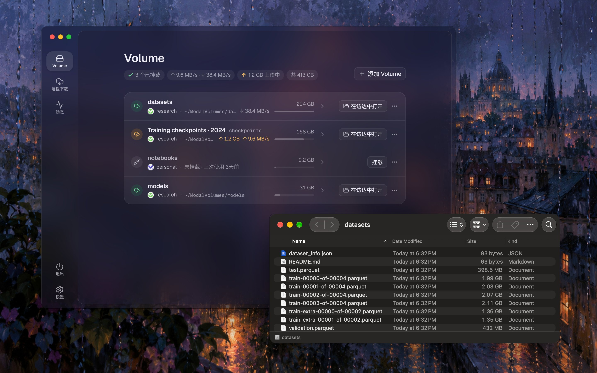
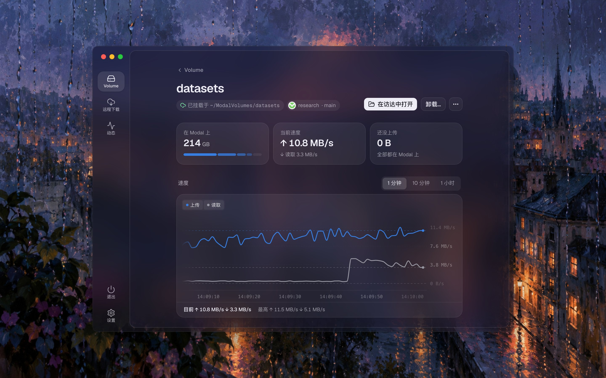
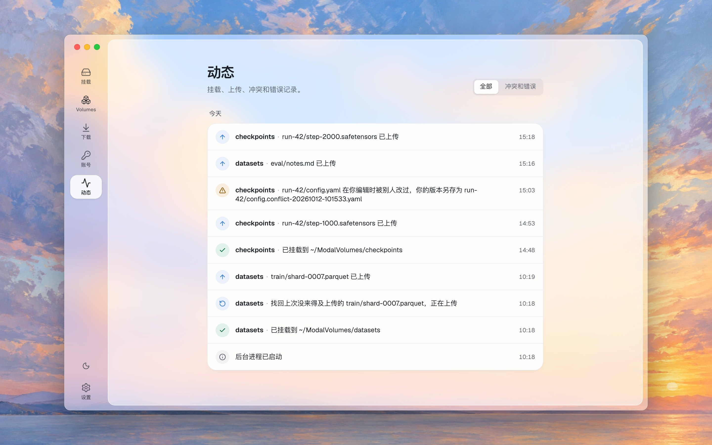
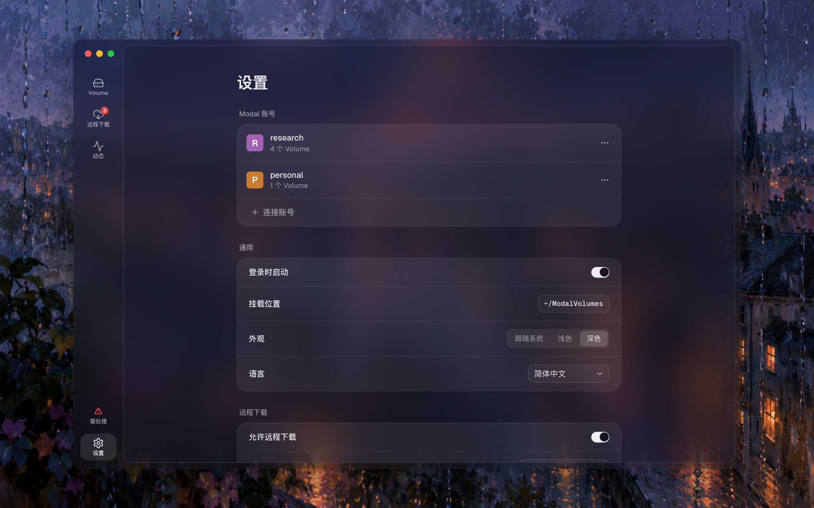

<p align="center">
  
</p>

<h1 align="center">modalfs</h1>

<p align="center">
  <b>把 Modal Volume 挂载成 Mac 上的文件夹。</b><br>
  文件按需流式读取，几 TB 的数据也能马上打开，不占满你的硬盘。
</p>

<p align="center">
  <a href="https://github.com/t41372/modalfs/actions/workflows/ci.yml"></a>
  <a href="https://github.com/t41372/modalfs/actions/workflows/modal-live.yml"></a>
  <a href="https://github.com/t41372/modalfs/actions/workflows/zizmor.yml"></a>
  <a href="https://github.com/t41372/modalfs/releases"></a>
  <a href="#安装"></a>
  <a href="go.mod"></a>
  <a href="LICENSE"></a>
</p>

<p align="center"><a href="README.md">English</a> · 简体中文</p>

<p align="center">
  
</p>

---

modalfs 把 [Modal Volume](https://modal.com/docs/guide/volumes) 放进你 Mac（或 Linux 电脑）上的一个文件夹。访达、编辑器、`ffmpeg` 和你的 agent 都像用其他文件夹一样用它。数据一直在 Modal 上，所以你在 Modal 上跑的任务读到的是同一批文件。

> [!IMPORTANT]
> modalfs 是独立项目，**与 Modal Labs 无关，也没有得到其认可**。它和 Modal 官方 SDK 用的是同一套 API，其中一部分没有公开文档，可能会变。把重要数据交给它之前，请先读[限制](#限制)。

> [!WARNING]
> modalfs 用的是你自己的 Modal 账号，所以你用它做的一切都受 [Modal 服务条款](https://modal.com/legal/terms)约束，违反条款的账号可能被 Modal 停用。条款（第 1.4 和 1.5 条）禁止的内容包括：侵犯版权的内容、点对点文件分享，以及为他人托管文件或提供媒体服务。下载种子就是点对点文件分享，因为它在下载的同时也在上传给其他用户。

## 目录

- [特点](#特点)
- [安装](#安装)
- [开始使用](#开始使用)
- [应用](#应用)
- [远程下载](#远程下载)
- [加密 volume](#加密-volume)
- [工作原理](#工作原理)
- [性能](#性能)
- [限制](#限制)
- [安全](#安全)
- [文件与设置](#文件与设置)
- [常见问题](#常见问题)
- [命令行](#命令行)
- [开发](#开发)
- [许可证](#许可证)

## 特点

- **文件马上打开。** modalfs 只读取应用要的那部分，直接从 Modal 读。从 100 GiB 文件中间读 4 KiB，只取一个 8 MiB 块。从头读到尾时，会一次提前取好几个块。
- **保存时只上传改过的部分。** 改动 100 GiB 文件里的 4 KiB，只上传一个 8 MiB 块。重命名和复制不传数据。大文件在后台上传，期间文件夹照常可用。
- **你现在用的应用都能直接用。** 它就是普通文件夹，访达、VS Code、Jupyter、`ffmpeg`、Blender 都不用额外设置。macOS 用系统自带的 NFS 客户端挂载，不用装内核扩展。Linux 用 FUSE。
- **你在 Modal 上的任务看到的是同一批文件。** 挂载这个 volume 的 Function 能读到你保存的内容，它提交的修改几秒内就会出现在你的文件夹里。
- **直接下载到 volume 里。** 粘贴一个链接，Modal Function 就会把它下载到 volume 里，你的 Mac 睡眠时也照样进行，还有实时速度图。这个功能打开之前一直关着，因为它是唯一会在 Modal 上运行计算的功能。
- **崩溃也不丢修改。** 每个修改都存在磁盘上，直到 Modal 收到为止，崩溃和断电也一样。同一个文件两边都改过时，两个版本都会保留。
- **挂载不会跑到别的 volume 上。** 每个挂载都绑定账号和 volume ID，所以切换 Modal CLI 的 profile 或给 volume 改名，都不会让它指向别处。
- **标签。** 给 volume 取个名字，空格、emoji、任何语言都行。标签存在 volume 里，所以每个用 modalfs 打开它的人看到的都一样，它的文件夹也用这个名字。脚本照旧用 Modal 上的 Volume 名称。
- **需要的话可以端到端加密。** 加密 volume 的文件、文件名和标签，Modal 都读不出来。它的密钥在哪台电脑上都能打开它。
- **一个小巧的原生应用**，带菜单栏图标，以及能做到应用里所有事情的[命令行](#命令行)。

## 安装

### macOS

需要 macOS 13 或更新版本。从 [Releases](https://github.com/t41372/modalfs/releases) 下载 `modalfs-<版本>-macos.zip`，解压后把 **modalfs.app** 拖进“应用程序”。同一个应用能在 Apple 芯片和 Intel 上运行。

应用只做了 ad hoc 签名，没有公证，所以第一次打开时 macOS 可能会拦下它。这时在访达里右键点按应用，选“打开”。

### Linux

从 [Releases](https://github.com/t41372/modalfs/releases) 下载 `modalfs-gui-<版本>-linux-amd64.tar.gz` 并解压。应用需要 WebKitGTK 4.1（`libwebkit2gtk-4.1-0`）和 FUSE（`fuse3` 软件包和 `/dev/fuse`）。其他架构的电脑，或者没有 WebKitGTK 时，请用[命令行](#命令行)：`modalfs ui` 会在浏览器里打开同样的应用。

## 开始使用

1. 打开 modalfs。
2. 连接你的 Modal 账号。你需要一个在 [modal.com → Settings → API Tokens](https://modal.com/settings/tokens) 创建的 API token，也可以让 modalfs 复制你在 Modal CLI 里已有的 profile。
3. 添加一个 volume，或者新建一个。它会出现在 `~/ModalVolumes` 里，可以在访达中打开。

## 应用

| 页面 | 内容 |
|---|---|
| **Volume** | modalfs 管理的 Volume，以及每个的状态（已同步、上传中、无法上传、有冲突、未挂载）、文件夹和大小。可以从账号里搜索并添加别的 Volume。Volume 的页面显示当前速度和最近一分钟、十分钟或一小时的速度、还没上传的内容、冲突，以及按文件夹的大小。所有设置都在同一处：标签、Volume 名称、登录时挂载、文件夹、只读、冲突时怎么办、加密密钥。 |
| **远程下载** | 添加链接、暂停、继续、删除。看正在下载的有哪些、多快、花多少，以及每个下载全程的速度。已完成的会折叠起来，每个都显示运行了多久、花了多少钱。 |
| **动态** | 挂载、上传、冲突、错误和崩溃恢复，按天分组。重要的还会发通知。 |
| **设置** | Modal 账号、登录时启动、挂载文件夹、浅色或深色、语言（English、繁體中文、简体中文）、远程下载，“高级”里还有缓存、预读和连接方式。 |

窗口只是个遥控器，挂载都在后台进程里。**关掉窗口不会卸载任何东西。** 在 macOS 上，modalfs 会留在菜单栏，图标显示是否都已传到 Modal。它的菜单列出你的 Volume（点一下在访达中打开，或挂载它），也能重新打开窗口。

**退出**（⌘Q，或菜单栏菜单、窗口里的“退出”）则不同：它会先上传剩下的内容，逐个卸载 Volume，然后退出。如果某个 Volume 还被应用占用，可以重试或强制卸载；**立即退出**则不再等待，也不会丢失任何内容，还没上传的会在下次挂载时上传。

<table>
  <tr>
    <td width="50%" valign="top">
      <a href="docs/screenshots/zh-CN/volume.jpg"></a>
    </td>
    <td width="50%" valign="top">
      <a href="docs/screenshots/zh-CN/activity.jpg"></a>
    </td>
  </tr>
  <tr>
    <td width="50%" valign="top">
      <a href="docs/screenshots/zh-CN/settings.jpg"></a>
    </td>
    <td width="50%" valign="top">
      <a href="docs/screenshots/zh-CN/download.jpg"></a>
    </td>
  </tr>
</table>

## 远程下载

给 modalfs 一个链接，你工作区里的一个 Modal Function 就会把它直接下载到 volume 里。这段时间你的电脑可以睡眠、断网甚至关机。文件下载完成后会出现在你选的文件夹里。

- **打开之前一直关着**，在“远程下载”页或设置里打开，因为这是 modalfs 唯一会运行计算的部分。只有你添加或继续一个下载时才会启动 Function，下载完成、暂停或卡住时就停止。
- **费用。** 最小规格（0.125 CPU、512 MiB）下载期间每小时约 0.01 美元，另加 Modal 的网络费用。实时查看一个下载，会多出约 2% 的流量。第一次下载，以及 modalfs 更新后的第一次，会用一个短命的 Sandbox 部署 Function：大约 10 秒、0.0001 美元。不需要安装 Python。
- **下载工具。** gopeed、aria2 和 yt-dlp，每次都用最新版。modalfs 会为每个链接选一个，你也可以自己选。gopeed 在某个服务器上一直失败时，aria2 会接手，从头下载那个文件。
- **Modal 的条款。** 只下载你有权下载的内容。种子属于点对点文件分享，[Modal 的条款](https://modal.com/legal/terms)（第 1.5 条）禁止这种用途，所以下载种子可能导致账号被停用。见[已知问题](docs/known-issues.md#bittorrent-uploads-while-it-downloads)。
- **中断。** Modal 有时会停掉容器来调度资源。下载进度存在 volume 上，所以会在新容器上从原来的地方接着下载，通常一分钟内。一个 Function 最多运行 24 小时，更久的下载会自己换到新的 Function。这些都会显示在下载的页面上。
- **实时速度**，在应用里看一个下载时每秒更新四次。它的状态、事件和速度历史也存在 volume 的 `.modalfs/downloads/` 里。
- **Cloudflare WARP。** 下载可以经由 Cloudflare WARP，适合会拒绝云服务器的网站。速度会慢一些，而且下载工具除了它什么都连不到：WARP 连不上时，下载会停下，而不是改成直连，你可以不经 WARP 重试。
- **不会覆盖。** 下载好的文件名字已被占用时，新文件会加上 ` (1)`。
- **花费。** “远程下载”页显示工作区和它的下载本月花了多少钱。Modal 的 API 不提供剩余额度和支出上限，所以这两项会链接到 Modal 的 Usage & Billing 页面。Modal 拒绝或停止一个下载时，下载的页面会说明原因，或者说明 Modal 没有给出原因。

远程下载目前还处理得不好的地方，见[已知问题](docs/known-issues.md)。

## 加密 volume

新建的 volume 可以端到端加密。文件、文件名和标签在离开你的电脑之前就加密了，所以 Modal，以及其他能读这个工作区的人，看到的都只是密文。在你的电脑上，文件夹照常使用。

新建 volume 时打开**端到端加密**。modalfs 随后会显示这个 volume 的密钥，是一行以 `mfs1-` 开头的文字。**把它存好，比如存进你的密码管理器。** 有了密钥和 Modal 上的文件，在任何电脑上都能读出它们，即使 modalfs 自己的文件都没了也一样。没有密钥，谁都读不出来，modalfs 也不行。没有口令，也没有找回的办法。

- 这台电脑会记住密钥（macOS 上存在钥匙串里，Linux 上存在系统的密码存储区或一个私有文件里），所以 volume 会自动挂载。在别的电脑上它会显示为已锁定：点**解锁**并粘贴密钥。
- 加密保护的是 Modal 上的数据，不是这台电脑上的。缓存、还没上传的修改和冲突副本在这里仍然读得到，忘记密钥之后也一样。把电脑交给别人之前，请在设置里清除缓存。
- Modal Function 读不了加密的 volume，远程下载也不能存进去。
- Modal 仍然看得到有多少文件和文件夹、它们怎么嵌套、大小、时间，以及哪些 8 MiB 块内容相同。
- 文件名最长 147 个字节（大约 49 个汉字）。重命名一个装了很多文件的文件夹，每个文件都要发一次请求。只有新建的 volume 能加密，密钥也不能更换。

[格式和它的取舍](docs/design/encryption.md)都完整写下来了，足以在没有 modalfs 的情况下解密一个 volume。

## 工作原理

<p align="center">
  
</p>

在 macOS 上，modalfs 从 `127.0.0.1` 把文件夹提供给系统的 NFS 客户端；在 Linux 上用 FUSE。背后是同一个后台进程，里面有从 Modal 读来的块的缓存、还没传到 Modal 的修改的日志，以及它见过的块的哈希。

**Volume v2 的文件是一串 8 MiB 的块**，每个块用它的 SHA-256 哈希命名。提交一个文件时，modalfs 把这串哈希发给 Modal，Modal 回答它还缺哪些块，modalfs 只上传这些。同一个块不会存两次，跨文件、跨 volume 也一样。读取时，Modal 为文件的任意一段返回每个块的签名 URL。复制文件只复制这串哈希：复制一个 100 GiB 的文件用了 2.9 秒。

所以改动文件的一部分，就是计算改动块的哈希，保留其余块的哈希，再上传 Modal 说缺少的块。但 Modal 的 API 从不返回已有块的哈希，所以 modalfs 用三种方式保存它们：

1. **存在这台电脑上。** modalfs 读到的每个完整块都会计算哈希，和文件的路径、大小、修改时间一起记下来。
2. **存在 volume 里。** modalfs 写入的 64 MiB 以上的文件，会把块列表存进 volume 里的 `/.modalfs/manifests/`，这样别的电脑和刚清空的缓存都能立刻编辑它们。只有文件的大小和时间仍然对得上时，才会用这份列表。
3. **读一遍。** 还没人记下的大文件，例如 Modal 容器刚写好的，第一次局部写入会把需要的块读一遍来算哈希，但不存到磁盘上。

**大文件边写边上传。** 长时间的复制中，每个块停止变动半秒后就上传，文件分段提交：每一段是从文件开头到第一个还没传到 Modal 的块为止，所以提交它不用再上传。每一段都是文件当时在块边界截断的样子，不会新旧混杂。上传同时进行 4 到 32 个，数量让每个块在你的网络上约 5 秒传完，因为单个连接只有几 MiB/s。

**其中一部分依赖 Modal 没有写明的行为**，是实测得出的，不是 Modal 承诺的。边写边上传依赖三件事：第一个块是虚构哈希的提交会给出上传 URL，但永远不会提交；这样上传的块，只有带上上传时返回的回执，才能用在之后的提交里，提交到这个 volume 的任何文件都行（modalfs 只用 10 分钟内的回执，15 分钟前的也试过仍然有效）；内容和哈希不符的块会被 Modal 拒收。测试每天对真实的 Modal 检查这几点。如果 Modal 改了，modalfs 会停止边写边上传，并在“动态”里说明；之后文件改回在提交时上传，和以前一样，不会丢数据。先上传但最终没有提交的块（例如文件先被删了，或程序崩溃）会留在 Modal 的块存储里，Modal 没有说明会不会清除它们、是否计费。

其他细节：

- **文件夹。** Modal 没有空文件夹，所以新建文件夹时会在里面写一个隐藏的 `.modalfs_keep` 文件。
- **重命名**会复制文件的块列表再删掉旧的，所以靠重命名来保存的编辑器可以正常工作。
- **冲突。** 每次提交前，modalfs 会再检查一次 Modal 上的文件。如果在你编辑期间别人改过它，你的版本会另存在旁边，名为 `name.conflict-YYYYMMDD-HHMMSS.ext`。也可以把 volume 设成覆盖。
- **macOS 的杂项文件。** `.DS_Store` 和 `._*` 文件只留在内存里，从不上传。可以按 volume 关闭。
- **账号。** modalfs 有自己的账号列表，secret 存在钥匙串里。它从不跟随 Modal CLI 当前启用的 profile，只在你导入时读取 `~/.modal.toml`。每个挂载都记住它的账号、环境、Volume 名称和 volume ID。volume 改名后，modalfs 会按 ID 找到它；如果它被删除、又有新的 volume 用了同一个名字，modalfs 会拒绝挂载，而不是在同一个文件夹里挂上另一个 volume。

## 性能

在一个 Linux arm64 沙箱里测得，经过带宽受限的 HTTP/1.1 代理。普通网络下会更快。

| 操作 | 结果 |
|---|---|
| 在 100 GiB 文件的 77 GiB 处冷读 4 KiB | 1.45 秒，之后从缓存读 0 毫秒 |
| 顺序读取 512 MiB | 40.9 MiB/s（沙箱把每个块的下载限制在约 7 MB/s） |
| 改动 100 GiB 文件中的 4 KiB | 上传 8 MiB，约 3.5 秒提交 |
| 改动 50 MB 文件中的 4 KiB | 上传 1 个块，2.0 秒 |
| 改动一个从没读过的 20 MB 文件中的 5 字节 | 读 2 个块算哈希，上传 1 个块，3.7 秒 |
| 复制或重命名 100 GiB 文件 | 2.9 秒，不传数据 |
| 写入途中 `kill -9`，然后重启 | 修改被恢复并提交，校验和一致 |

## 限制

- **只支持 Volume v2。** v1 volume 会列出来，但无法挂载。
- **没有锁。** Modal 没有比较并交换，所以多个写入者改同一个文件时，最后一次提交胜出。modalfs 能发现时会保留一份冲突副本。
- **8 MiB 的块。** 小的随机写入也会上传整个 8 MiB 块。
- **元数据。** Modal 在提交时设置文件的修改时间。modalfs 接受 chmod、chown 和 utimes，但会忽略它们。不支持符号链接、硬链接和扩展属性。
- **一致性。** 打开一个文件时，看到的是那时最后提交的版本，文件夹会缓存 10 秒，所以其他电脑上的改动会在这段时间内出现。Modal 容器需要调用 `volume.reload()` 才能看到你写的内容。
- **回写延迟。** NFS 不会告诉 modalfs 文件何时关闭，所以修改在文件停止变动约 3 秒后才传到 Modal，持续变动的文件每 30 秒提交一次。崩溃后会恢复。一个例外：如果追加写入的最后一秒全是零字节，这些结尾的零可能会丢失。
- **卸载要等上传**，并显示进度。**立即卸载**会马上卸载，剩下的在后台或下次挂载时上传。macOS 不会卸载正被应用打开的文件夹，modalfs 会告诉你是哪个应用。
- **内存小的 Mac 上，大文件复制会停顿。** 系统的 NFS 客户端会自己每 30 秒才发出一批写入（7.5 GB 内存的 Mac 上每批约 100 MB），其间复制和访达都要等。见[已知问题](docs/known-issues.md#large-copies-pause-on-a-mac-with-little-memory)。
- **挂载期间后台进程必须一直运行**，因为是它在提供这些文件夹。如果它挂了，下次启动时会清理它留下的挂载。
- **菜单栏图标只在 macOS 上有。** 在 Linux 上运行 `modalfs ui` 重新打开窗口。
- **未公开的 API。** modalfs 用的是 Modal SDK 所用的调用。如果 Modal 改了它们，modalfs 在更新之前可能无法使用。
- **它还很新。** 遇到问题请报告。

## 安全

- **Token secret** 存在 macOS 钥匙串或 Linux Secret Service 里。没有它们的 Linux 电脑上，会存进权限为 `0600` 的 `secrets.json`。它们从不写进日志。
- **后台进程**为应用和命令行监听一个只有你能读的 Unix 套接字，并为浏览器监听一个随机的 `127.0.0.1` 端口。`modalfs ui` 打开的链接带一个只能用一次的 token，用后换成 cookie。每个请求还需要回环地址的 `Host` 头和一个自定义请求头，以挡住其他网页和 DNS 重绑定。
- **NFS 服务**只监听 `127.0.0.1`，只接受带你这个用户凭据的请求，所以共用这台 Mac 的其他人挂载不了你的 volume。它防不住什么，见[已知问题](docs/known-issues.md)。
- **删除** volume 或移除账号之前会先问你。已挂载的 volume 不能删除。
- 请按 [SECURITY.md](SECURITY.md) 私下报告安全漏洞，不要发在公开的 issue 里。

## 文件与设置

| | macOS | Linux |
|---|---|---|
| 设置、账号、套接字、日志 | `~/Library/Application Support/modalfs/` | `~/.config/modalfs/` |
| 块缓存 | `~/Library/Caches/modalfs/` | `~/.cache/modalfs/` |
| 挂载文件夹 | `~/ModalVolumes/` | `~/ModalVolumes/` |
| 登录时启动 | `~/Library/LaunchAgents/dev.modalfs.daemon.plist` | `~/.config/systemd/user/modalfs.service` |

**缓存大小**是 modalfs 占用的全部磁盘空间：从 Modal 读来的块（所有 Volume 共用），加上还没传到 Modal 的修改。修改优先，缓存的块会给它们让位。修改占满缓存时（除了留给读取的四分之一，最多 1 GiB），新的写入会等上传腾出空间。比缓存大的复制照样能完成，速度就是你的上传速度，也不会把磁盘塞满。长时间的复制会边写边上传，每一段提交后就从磁盘上释放，所以一次写入只需等一两个块，不必等整个文件。不过在 macOS 上，这样的复制一旦需要等待，每次可能停顿半分钟以上，因为系统的 NFS 客户端也会把写入压住，所以缓存最好比你最大的一次复制还大。磁盘剩余空间不到 1 GiB 时，写入也会等待；如果没有待上传的内容能腾出空间，就会立即失败，并在“动态”里显示错误。

连不上 Modal 时，往 Volume 写入的应用会等待。在 macOS 上几分钟后会放弃，就像任何断开的网络硬盘一样。已经写进去的内容留在这台电脑上，之后再上传，应用里会显示无法上传以及原因。

缓存可以设成 1 以上的任意整数 GB。默认是 20 GB，建议至少 2 GB（大约是 2 × 同时读取的文件数 × (预读块数 + 1) × 8 MiB，再加 256 MiB）。

## 常见问题

**挂载会花 Modal 的计算费用吗？**
不会。挂载只调用 API。存储和流量照常由 Modal 计费。只有[远程下载](#远程下载)会运行 Function，而它在你打开之前一直关着。

**Modal Function 能同时使用这个 volume 吗？**
可以。在容器里调用 `volume.reload()` 就能看到通过 modalfs 做的改动。不要让两边同时写同一个文件。

**为什么 macOS 上用 NFS 而不是 FUSE？**
macFUSE 要先安装，还要在 Mac 的安全设置里允许它。系统自带的 NFS 客户端什么都不用装。如果你已经在用 macFUSE，可以在 volume 设置的“高级”里把**连接方式**设成 FUSE。

**应用必须一直开着吗？**
不用。只有后台进程需要一直运行。打开**登录时启动**和**登录时挂载**，每次重启后 volume 都会在。

**崩溃之后我的修改去哪了？**
modalfs 会在下次启动时重放并提交它。“动态”里会有一条“找回”记录；如果 Modal 上的文件在此期间被改过，会有一份冲突副本。

## 命令行

大部分人用不到它，但应用能做的事命令行都能做：两者连的是同一个后台进程。

### 安装

在 macOS 上，应用里已经带了命令行。要在终端里使用：

```sh
sudo ln -sf /Applications/modalfs.app/Contents/Resources/bin/modalfs /usr/local/bin/modalfs
```

只要命令行的话，从 [Releases](https://github.com/t41372/modalfs/releases) 下载 `modalfs-<版本>-darwin-arm64.tar.gz`（或 `-darwin-amd64`、`-linux-amd64`、`-linux-arm64`）：

```sh
tar -xzf modalfs-*-linux-amd64.tar.gz
sudo install modalfs-*-linux-amd64/modalfs /usr/local/bin/modalfs
```

Linux 上需要支持 FUSE（`fuse3` 软件包和 `/dev/fuse`）。`go install github.com/t41372/modalfs/cmd/modalfs@latest` 也能用，但它没法构建应用的界面，这时 `modalfs ui` 会显示一页说明。

### 快速上手

1. **添加账号。** 在 [modal.com → Settings → API Tokens](https://modal.com/settings/tokens) 创建一个 token，然后：

   ```sh
   modalfs account add                    # 会提示输入 Token ID 和 Secret
   modalfs account import                 # 或者复制 Modal CLI 的 profile
   ```

2. **挂载一个 volume**，需要的话先创建：

   ```sh
   modalfs volume create my-data
   modalfs mount my-data                  # ~/ModalVolumes/my-data
   ```

3. **开始使用。** 在访达或编辑器里打开这个文件夹。文件停止变动约 3 秒后，修改会被提交。

   ```console
   $ echo hi >> ~/ModalVolumes/my-data/notes.md
   $ modalfs status
   VOLUME   ACCOUNT  STATE    MOUNTPOINT                      PENDING  DOWN/UP
   my-data  work     mounted  /Users/me/ModalVolumes/my-data  0        0 B / 3 B
   ```

4. 用完后**卸载**。还没上传的内容会先传完。

   ```sh
   modalfs unmount my-data
   ```

modalfs 会记住每个挂载，所以下次 `modalfs mount my-data` 会沿用同一个账号、环境和文件夹。

### 命令参考

```
日常
  modalfs ui [--print]                        打开应用（需要时启动后台进程）；
                                              --print 改为显示浏览器地址
  modalfs status                              各个挂载及其上传情况
  modalfs mount VOLUME [MOUNTPOINT]           挂载并记住它
        [--account A] [--env E] [--ro] [--auto] [--mode auto|nfs|fuse] [--keep-junk]
  modalfs unmount VOLUME|PATH [--now]         上传待上传的内容，然后卸载；
                                              --now 立即卸载，剩下的在后台继续上传
  modalfs sync VOLUME|PATH                    立即上传待上传的内容
  modalfs forget VOLUME|PATH                  删除保存的挂载（volume 本身不受影响）
  modalfs info VOLUME|PATH [--measure]        大小、等待上传的文件、未处理的冲突；
                                              --measure 列出整个 volume 来计算大小
  modalfs conflicts VOLUME|PATH [--handled]   冲突副本；--handled 全部标为已处理

Volume
  modalfs volume ls      [--account A] [--env E]
  modalfs volume create  NAME [--label L] [--account A] [--env E] [--mount]
  modalfs volume rename  NAME NEWNAME [--account A] [--env E]
  modalfs volume label   NAME [LABEL | --clear]   代替 NAME 显示的名字，存在 volume 里
  modalfs volume rm      NAME [--account A] [--env E] [--yes]

加密 volume
  modalfs volume create  NAME --encrypt       显示新 volume 的密钥；存好之后再继续
  modalfs unlock VOLUME [--remember=false]    用密钥解锁（手动输入，或从 stdin 读取）；
                                              这台电脑会记住它，除非加 --remember=false
  modalfs lock VOLUME                         让这台电脑忘掉密钥（先卸载）
  modalfs volume key     NAME                 显示密钥（仅限记住了它的电脑）
  modalfs volume decrypt NAME --to FOLDER     只用密钥，把所有文件解密复制出来

账号
  modalfs account add [--label L] [--token-id ID] [--env E]
  modalfs account import [PROFILE...]
  modalfs account ls
  modalfs account check ACCOUNT               问 Modal 这个 token 是否仍然有效
  modalfs account token ACCOUNT               更换过期的 token（必须是同一个工作区）
  modalfs account rename ACCOUNT NEWNAME
  modalfs account env ACCOUNT ENVIRONMENT     添加 volume 时在哪个环境里查找
  modalfs account rm ACCOUNT

远程下载（打开之前是关着的；每个下载都在 Modal Function 里运行，向你的账号计费）
  modalfs download enable|disable             打开或关闭远程下载
  modalfs download add VOLUME[:/FOLDER] URL...
        [--downloader gopeed|aria2|yt-dlp] [--size small|medium|large] [--cookies FILE]
        [--warp | --no-warp] [--account A] [--env E]
  modalfs download ls
  modalfs download show ID [--follow]         进度、执行次数和中断、速度
  modalfs download pause ID
  modalfs download resume ID [--warp | --no-warp]
  modalfs download cancel ID [--keep]         停止并删除下载了一半的文件
  modalfs download logs ID                    下载工具的日志
  modalfs download rm ID                      从列表移除（下载好的文件保留）
  modalfs download spend [--account A]        工作区和它的下载本月花了多少钱

后台进程
  modalfs daemon                              在前台运行后台进程
  modalfs quit [--now]                        上传所有内容、卸载、停止后台进程；
                                              --now 立即停止（待上传的内容在下次挂载时上传）
  modalfs service install|uninstall           登录时启动（LaunchAgent / systemd 用户单元）
  modalfs cache clear                         删除块缓存（还没上传的修改会保留）

不经过后台进程（脚本、调试）
  modalfs run VOLUME MOUNTPOINT [flags]       在前台挂载，直到 Ctrl-C
  modalfs serve VOLUME [flags]                只启动 NFS 服务，并打印挂载命令
```

`--account` 可以是名称、账号 ID 或工作区名称，只有一个账号时可以省略。

例如，一个远程下载：

```console
$ modalfs download enable
$ modalfs download add datasets:/raw https://example.org/train-2024.tar
$ modalfs download show dl-3f2a --follow
```

### 环境变量

| 变量 | 作用 |
|---|---|
| `MODALFS_HOME` | 把设置和缓存放到别处（测试时很方便） |
| `MODALFS_TRANSPORT=http1` | 通过 HTTP/1.1 调用 API，用于只允许 HTTP/1.1 的代理 |
| `MODALFS_NO_KEYCHAIN=1` | 把 secret 存进 `secrets.json`，不用钥匙串 |
| `MODALFS_DEBUG=1` | 输出更多日志 |

## 开发

需要 Go 1.26 或更新版本、用来构建界面的 [Bun](https://bun.sh) 和 [just](https://github.com/casey/just)。macOS 应用还需要 Xcode 命令行工具（`xcode-select --install`），Linux 应用需要 `libgtk-3-dev` 和 `libwebkit2gtk-4.1-dev`。运行 `just` 可以列出全部任务。

```sh
git clone https://github.com/t41372/modalfs && cd modalfs
just app             # macOS 应用：dist/modalfs.app，支持 Apple 芯片和 Intel
just linux-gui       # Linux 应用：dist/modalfs-gui
just cli             # macOS 和 Linux 的命令行：dist/modalfs-{darwin,linux}-{arm64,amd64}
just build           # 本机的命令行：dist/modalfs
just dev-mock        # 热重载的界面，用示例数据：不需要后台进程和 Modal 账号
just dev             # 热重载的界面，连接你正在运行的后台进程
just lint            # gofmt、go vet，以及界面的类型检查和翻译检查
just test-e2e        # 真实的 NFS 挂载，连接网速受限的假 Modal（macOS）
just fake -up 20M    # 假的 Modal，不用账号就能试 modalfs
MODALFS_TEST_VOLUME=scratch just test-integration   # 会在这个 volume 里创建和删除文件
```

在 macOS 12 上可以用 `MIN_MACOS=12.0 just app` 构建应用，但没有测试过，也不提供支持。

界面用 React、Tailwind 和基于 Base UI 的 shadcn/ui 写成，风格与 [Jezo](https://github.com/t41372/Jezo) 一致。`just ui` 把它构建到 `internal/webui/dist`，由后台进程和应用嵌入。

本文的图片都是生成的：`cd web && bun run screenshots` 用 `web/src/api/mock.ts` 里的示例数据给界面截图，`bun run diagrams` 画出“工作原理”的图。第一张截图另外放了一个真实的访达窗口，由 `web/scripts/capture-finder.sh` 从挂载的假 Modal 上截取。

| 文件夹 | 内容 |
|---|---|
| `cmd/modalfs` | 命令行和后台进程 |
| `cmd/modalfs-gui` | 桌面应用（Wails），也可以运行后台进程 |
| `internal/modalapi` | Modal 的 API、块的上传和下载 |
| `internal/vfs` | 文件系统：缓存、修改、日志、冲突 |
| `internal/nfsfront`、`internal/fusefront` | NFS 和 FUSE 服务 |
| `internal/daemon` | 挂载、JSON API、登录时启动 |
| `internal/config` | 账号、保存的挂载、设置、secret |
| `web` | 界面（React、Vite），文案在 `web/src/i18n` |
| `packaging` | 图标和 macOS 应用打包 |
| `docs` | 设计说明、已知问题、本文的图片 |

欢迎贡献，在真实 Mac 上测试最有帮助。见 [CONTRIBUTING.md](CONTRIBUTING.md)（英文）；提交 PR 前请运行 `just lint`，可以的话再用一个临时 volume 跑一遍集成测试。

## 许可证

[Apache License 2.0](LICENSE)。

Modal 是 Modal Labs, Inc. 的商标。本项目与 Modal Labs 无关。
